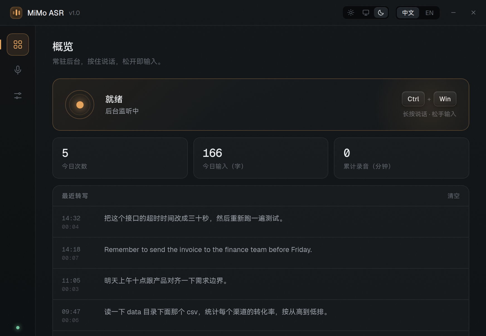
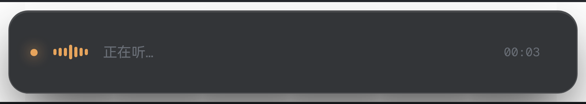
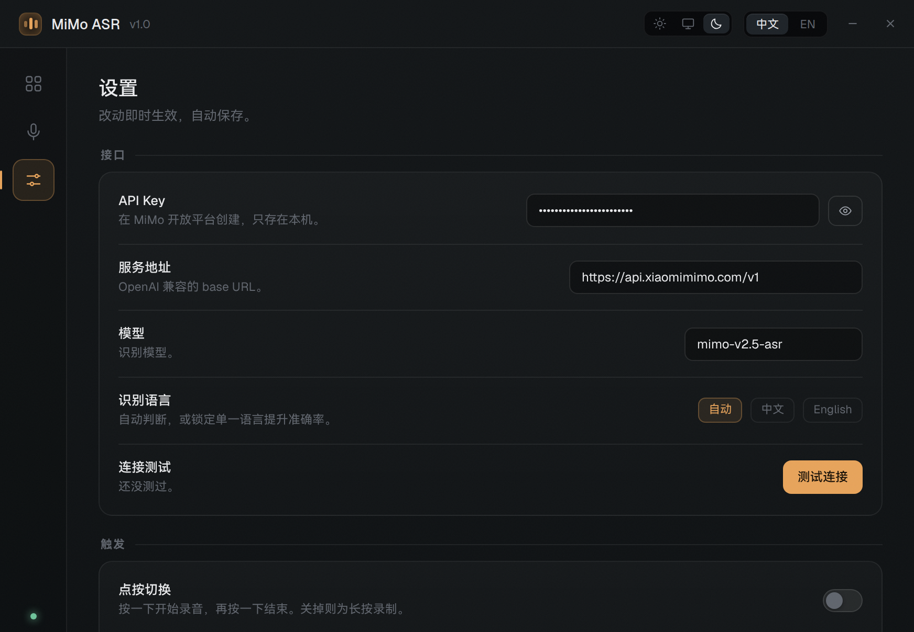
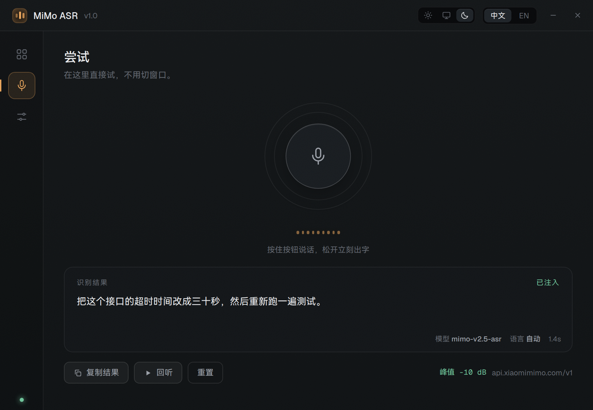
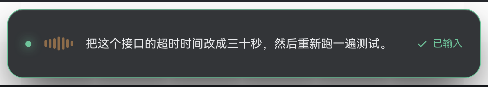

<div align="center">

# voiceinput-linux

**MiMo 语音输入法 · 优雅 UI for Linux · 支持自配置 ASR API**

按住快捷键说话，松手把整段文字注入到当前焦点窗口。



</div>

<br>

<div align="center">

</div>

## 它是什么

一个常驻托盘的桌面语音输入工具。按住 `Ctrl + Win` 说话，界面底部浮出一条窄窗实时出字，松手后整段文字直接打进你正在编辑的地方——编辑器、终端、浏览器输入框都行。

识别走小米 **MiMo-V2.5-ASR**，API Key 自己填，也可以换成任何 OpenAI 兼容的 ASR 端点。

原生支持 Wayland（COSMIC / GNOME / KDE），X11 同样可用。

## 特性

- **两种触发**：长按说话松手输入，或按一下开始、再按一下结束
- **任意快捷键**，包括 `Ctrl + Win` 这种纯修饰键组合
- **流式出字**：识别结果逐字浮现在悬浮窗，松手后整段一次注入，不做打字机模拟
- **回听原始录音**：每次录音留一份 wav，配合峰值电平判断到底是没录到还是识别不准
- **失败自动复制**：输入桥接报错、无输入焦点或焦点变化时，自动复制完整识别结果，提示手动粘贴；不发送合成键
- **剪贴板**：本机保存最近 50 条文字/图片；图片可选择复制图像或文件路径，支持选择图片导入
- **实时电平**：悬浮窗波形由真实音频驱动
- **日间 / 夜间 / 跟随系统**：三态主题，全部走 CSS 变量
- **中英双语**界面
- **录音边界精确**：常驻采集 + 环形缓冲，按下那一刻就是起点，松手那一刻就是终点
- **配置可复用**：`~/.config/mimo-asr/config.json`，也认 `MIMO_API_KEY` 环境变量，附 CLI 供其他脚本调用

## 安装

```bash
git clone https://github.com/connectedGraph/voiceinput-linux.git
cd voiceinput-linux

sudo apt install pulseaudio-utils fcitx5
./install.sh                       # 依赖、图标、启动器
sudo ./install.sh --grant-input    # 全局热键所需的键盘读取权限
```

`--grant-input` 会装一条 udev 规则，给当前用户 `/dev/input/event*` 的**读**权限，立即生效，不需要重新登录。撤销：`sudo ./install.sh --revoke-input`。

> 这条权限意味着该用户能读到所有键盘输入事件（包括密码）。所有 Linux 全局热键工具都是这个做法——Wayland 没有别的合法途径，COSMIC 的 portal 也没实现 GlobalShortcuts。不想给的话，托盘菜单和面板里的按钮仍然能触发录音，只是全局快捷键失效。

启动后到 **设置 → 接口** 填上 MiMo 的 API Key，点「测试连接」确认通畅。

> 磁盘占用：Electron 自带 55 种语言包，`./install.sh` 会自动裁到中英文，安装体积少约 40 MB。
> 已经装过的可以随时重跑：`npm run trim`。

## 使用

| 操作 | 效果 |
|---|---|
| 按住 `Ctrl + Win` | 开始录音，悬浮窗出现 |
| 松开 | 立即停止，上传识别，结果整段注入 |
| 点按切换模式 | 按一下开始，再按一下结束 |
| 左键托盘图标 | 打开面板 |
| 托盘右键 | 开始录音 / 尝试页 / 退出 |

快捷键、模式、注入方式、主题、悬浮窗位置都在设置里改，改完立即保存。

## 界面

<div align="center">


</div>

<br>

<div align="center">


</div>

## 录音边界为什么值得单独说

最常见的写法是"按下才启动录音、松手才停"。这个写法一定会慢一拍：`parec` 从进程创建到读出第一块音频要几十到几百毫秒，这段时间说的话没录进去；停止时进程退出前缓冲里的尾巴也会丢。

这里改成**常驻采集 + 环形缓冲**：采集进程在应用启动时就跑起来，一直写进 5 秒的环形缓冲；按下只做一件事——从缓冲里精确回补 350ms 并打标记；松手立刻冻结，之后的数据直接丢弃。

边界由标记决定，跟进程启停完全无关。实测按住 2.0 秒，wav 时长 2.39 秒（2.0 + 0.35 预录 + 管线余量）。

代价是麦克风常驻，系统会一直显示麦克风占用。不想这样可以在 **设置 → 输出 → 麦克风常驻** 关掉：关掉后录音结束就释放麦克风，下次按下要重新启动采集，开头会慢一点。

细节和踩过的坑写在 [docs/IMPLEMENTATION.md](docs/IMPLEMENTATION.md)。

## 配置

`~/.config/mimo-asr/config.json`，600 权限。

加载优先级：环境变量 > 项目 `.env` > 配置文件 > 内置默认。

```json
{
  "apiKey": "",
  "baseUrl": "https://api.xiaomimimo.com/v1",
  "model": "mimo-v2.5-asr",
  "asrLanguage": "auto",
  "mode": "hold",
  "hotkey": ["Ctrl", "Super"],
  "injectMethod": "fcitx",
  "stripTrailingPunct": false,
  "theme": "auto"
}
```

`hotkey` 是逻辑键名数组，`Super` 就是 Win 键。`injectMethod` 为 `fcitx` 时，整段文本通过 Fcitx `commitString` 一次提交，成功提交时不写剪贴板，不发送合成键。目标窗口必须有可用的输入法上下文。报告失败时自动复制结果，需手动粘贴。

剪贴板记录保存在 `~/.config/mimo-asr/clipboard/`，最多 50 条。截图没有原路径时保留一份 PNG，供“复制路径”使用；导入图片保留原文件路径。清空记录会删除历史缓存图像，不清空系统剪贴板。侧栏或托盘均可打开剪贴板。

诊断日志：`~/.local/state/mimo-asr/events.jsonl`，记录启动 PID、焦点捕获、ASR 增量字符数、输入法回执与自动复制状态；超过 1 MB 轮转一份。默认不记录识别正文。

## 命令行

```bash
mimo-asr --config                    # 看配置（key 打码）
mimo-asr --ping                      # 测连接
mimo-asr --transcribe a.wav          # 识别任意 wav
mimo-asr --transcribe a.wav --json   # 结构化输出
```

## 接口约定

- `POST {baseUrl}/chat/completions`，OpenAI 兼容
- 模型仅 `mimo-v2.5-asr`
- 音频**只支持 wav / mp3**，Base64 后上限 10 MB（16k 单声道约 3.5 分钟）
- `asr_options.language`：`auto` / `zh` / `en`
- `stream: true` 是**结果流式返回**，音频本身一次性上传

## 已知限制

- 仅 Linux
- 自动注入依赖输入法上下文。终端使用 `Ctrl+Shift+V` 粘贴不影响其输入法支持；没有输入法上下文或桥接报错时自动复制，手动粘贴即可
- “已提交给输入法”表示桥接接受文本，无法通用地确认任意目标软件实际显示。未显示时可通过托盘“复制最近识别结果”手动取回
- 单次录音上限约 3.5 分钟
- 输入法桥接依赖当前会话中的 Fcitx5；桥接未加载时界面会显示明确错误，识别结果仍保留在历史记录

## 结构

```
src/main.js        主进程：窗口、托盘、状态机、IPC
src/recorder.js    常驻采集 + 环形缓冲
src/evdev.js       全局热键（直接读 /dev/input）
src/asr.js         MiMo 流式识别
src/inject.js      文字注入
src/ui/            面板与悬浮窗
bin/mimo-asr.js    命令行入口
docs/              实现说明与截图
```

## License

MIT
